# TWAS-MetaXcan：四疾病 TWAS × CMap Level 5 候选化合物筛选

本项目把公开 GWAS、MetaXcan 与 LINCS/CMap Level 5 串成一个可复现、可审计的候选化合物筛选流程。当前预注册四个**相互独立**的疾病分析：

- Alzheimer's disease（AD，阿尔茨海默病）
- Lichen simplex chronicus / neurodermatitis（LSC，慢性单纯性苔藓/神经性皮炎）
- Atopic dermatitis（特应性皮炎）
- Idiopathic pulmonary fibrosis（IPF，特发性肺纤维化）

> **结果状态：**软件最小闭环已经跑通；demo 命令生成的 `demo_output` 来自 synthetic data，仅用于验证代码。`REV_*` 等名称不是实际药物，也不能作为生物学结论。真实候选必须在下载正式 GWAS 和 GSE92742 Level 5 数据、完成正式 10,000 次置换后产生。

## 一图看懂 pipeline

```mermaid
flowchart LR
    A[冻结公开数据版本<br/>URL + metadata + SHA-256] --> B[GWAS 标准化<br/>GWAS-VCF]
    B --> C[等位基因 harmonization<br/>summary imputation]
    C --> D[S-PrediXcan<br/>组织特异性 signed Z-score]
    D --> E[与 CMap Level 5 MODZ<br/>按 gene 对齐]
    E --> F[weighted cosine<br/>负值 = 疾病方向逆转]
    F --> G[compound × cell<br/>signature 中位数聚合]
    G --> H[匹配置换检验<br/>cell / dose / time]
    H --> I[每个疾病内 global BH-FDR]
    I --> J[4 个独立候选表<br/>图形 + manifest + hashes]
```



S-MultiXcan 用于跨组织关联证据；候选化合物的方向只来自预先指定组织的 **S-PrediXcan Z-score**，不会用联合 `z_mean` 代替方向。

## 预注册分析设置

| 疾病 | 主要公开 GWAS | TWAS 组织 | Primary CMap cells | Secondary cells |
|---|---|---|---|---|
| AD | GCST90027158 | `Brain_Cortex` | `NEU`, `NPC` | `SHSY5Y` |
| LSC | FinnGen R12 `L12_LICHENSIMPLEX` | `Skin_Not_Sun_Exposed_Suprapubic` | `MCH58` | `A375`, `SKMEL1`, `SKMEL28` |
| Atopic dermatitis | GCST90244787 | `Skin_Not_Sun_Exposed_Suprapubic` | `MCH58` | `A375`, `SKMEL1`, `SKMEL28` |
| IPF | FinnGen R12 `IPF` | `Lung` | `HCC515` | `A549`, `SKLU1` |

`HCC515` 是 IPF 的肺来源 proxy，并非理想的原代肺成纤维细胞。Secondary cells 只做敏感性分析，不能把化合物提升为候选。

完整冻结配置：

- 数据集：[config/datasets/four_disease_public.yaml](config/datasets/four_disease_public.yaml)
- 分析参数：[config/drug_screens/four_disease_level5.yaml](config/drug_screens/four_disease_level5.yaml)
- 正式设计与预注册：[docs/superpowers/specs/2026-11-12-four-disease-cmap-level5-design.md](docs/superpowers/specs/2026-11-12-four-disease-cmap-level5-design.md)

## 先跑 5 分钟 synthetic demo

```bash
conda env create -f envs_metaxcan.yaml
conda activate MetaXcan
python scripts/run_minimal_four_disease_demo.py --output demo_output/four_disease
```

Demo 会生成 mini-GCTX、四份 synthetic TWAS、四个独立候选列表、审计清单及 8 组 PNG/SVG/PDF 图。它只验证以下闭环能正常运行：GCTX 分块读取、gene 对齐、评分、置换、FDR、候选判定、绘图和数据谱系。

## 正式数据运行

### 1. 检查并下载冻结数据

先查看将要使用的数据，不会下载：

```bash
python twas.py datasets config/datasets/four_disease_public.yaml --list
```

按 ID 下载到快照目录；下载支持续传并记录 checksum：

```bash
python twas.py datasets config/datasets/four_disease_public.yaml \
  --output data/four_disease_snapshot \
  --select AD_GCST90027158 LSC_FINNGEN_R12 ADERM_GCST90244787 IPF_FINNGEN_R12

python twas.py datasets config/datasets/four_disease_public.yaml \
  --output data/four_disease_snapshot \
  --select CMAP_LEVEL5_GCTX CMAP_SIG_INFO CMAP_PERT_INFO CMAP_GENE_INFO
```

CMap 主文件约 21.3 GB。保留官方 `.gctx.gz` 作为只读归档，将其解压到本地 scratch 后再做 HDF5 随机访问；不建议直接在 Google Drive 同步盘上计算。

### 2. 为四个疾病生成完整 TWAS 结果

每个 trait 配置依次执行：GWAS-VCF 标准化 → harmonization → summary imputation → S-PrediXcan → S-MultiXcan → summary。

```bash
python twas.py run config/traits/AD_Bellenguez2022.yaml
python twas.py run config/traits/IPF_FinnGen_R12.yaml
```

LSC 和 Atopic dermatitis 需要按 [config/traits/TEMPLATE.yaml](config/traits/TEMPLATE.yaml) 建立对应 trait YAML，再运行同一命令。四份正式输入最终应与 `config/drug_screens/four_disease_level5.yaml` 中的 `twas` 路径一致。

### 3. 运行 CMap Level 5 正式筛选

确认配置中的 `.gctx`、metadata 和四份 TWAS 路径后执行：

```bash
python twas.py four-disease-screen config/drug_screens/four_disease_level5.yaml
```

正式配置固定使用 10,000 次置换；不要用 demo 的 999 次结果替代正式分析。

筛选完成后，可从审计表生成与 demo 相同的 8 组发表级图形：

```bash
python - <<'PY'
from twaslib.screen_figures import render_figure_suite
render_figure_suite("results/four_disease_cmap_level5", formats=("png", "svg", "pdf"))
PY
```

## 核心统计规则

- 将 tissue-specific S-PrediXcan Z-score 截断到 `[-5, 5]`，权重为 `min(|Z|, 5) / 5`。
- TWAS 与 CMap MODZ 计算 continuous weighted cosine；分数越负，逆转疾病遗传表达方向越强。
- 同一 compound × cell 的多条 signature 取中位数，避免重复实验数量直接主导排名。
- 置换的是 signature label，并按 `cell/dose/time → cell/time → cell` 分层匹配，同时保持每组 replicate 数量。
- 在**每个疾病内部**，对全部 compound × primary-cell 假设统一做 Benjamini-Hochberg FDR；四个疾病不混池排名。
- 候选门槛：至少一个 primary-cell 检验 `global q < 0.05`，且所有已测试 primary cells 的聚合分数均为负。
- 不自动放宽阈值。若 LSC 等低样本量分析无显著候选，应如实报告空列表。

## 输出与审计

默认输出目录：`results/four_disease_cmap_level5/`。

```text
results/four_disease_cmap_level5/
├── AD/
│   ├── candidate_compounds.tsv
│   ├── all_primary_tests.tsv
│   ├── secondary_contexts.tsv
│   ├── signature_evidence.tsv.gz
│   └── report_zh.md
├── LSC/                    # 同样结构
├── atopic_dermatitis/      # 同样结构
├── IPF/                    # 同样结构
├── figures/                # PNG / SVG / PDF
├── input_manifest.json
├── output_manifest.json
└── runtime_versions.json
```

每个疾病单独产出一个候选表；同时保留全量检验、置换统计、输入/输出 SHA-256、运行参数和软件环境。这样可以追溯任一候选来自哪个 GWAS、TWAS tissue、CMap signature 和配置版本。

## 环境安装

本仓库依赖 [MetaXcan](https://github.com/hakyimlab/MetaXcan) 和 [summary-gwas-imputation](https://github.com/hakyimlab/summary-gwas-imputation)：

```bash
git clone https://github.com/hakyimlab/MetaXcan
git clone https://github.com/hakyimlab/summary-gwas-imputation
conda env create -f envs_metaxcan.yaml
conda env create -f envs_gwasimputation.yaml
conda env create -f envs_vcftools.yaml
mkdir -p data
(cd data && curl -L "https://zenodo.org/api/records/3657902/files/sample_data.tar/content" | tar -xf -)
```

Zenodo reference bundle 约 16.7 GB，包含 1000G EUR/LD、liftover chains、GTEx v8 MASHR eQTL/sQTL models 和 covariance。解释器及数据路径统一配置在 [config/pipeline.yaml](config/pipeline.yaml)。

中断后可直接重跑；已存在且有效的步骤输出会被跳过。长任务可用：

```bash
bash run_detached.sh config/traits/AD_Bellenguez2022.yaml
```

## 测试

```bash
MPLCONFIGDIR=/tmp/twas-mpl python -m unittest discover -s tests -p 'test_*.py' -v
```

## 解释边界

- TWAS 是遗传预测表达与疾病的关联，不等同于因果基因或患者组织中的实测 differential expression。
- CMap 的细胞系、剂量和时间与临床暴露不同；proxy cell 的结论必须单独标注。
- 排名用于候选优先级，不代表疗效。后续仍需毒性、可达暴露、靶点机制、独立队列和 wet-lab validation。
- 正式研究应保留全部阴性结果、敏感性分析和版本化数据谱系，不能只展示 top hits。

更多方法细节见 [docs/twas_drug_screen.md](docs/twas_drug_screen.md)。旧版单疾病入口仍可使用：

```bash
python twas.py drug-screen config/drug_screens/ad_template.yaml
```

可选 Web UI：`bash webapp/start.sh`，然后访问 `http://localhost:8000`。
